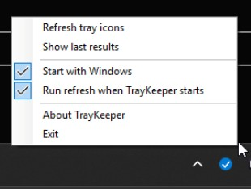

# TrayKeeper

A lightweight Windows 11 tray utility that re-enables notification-area icons which Windows
hid after an application update.



## Download

Grab the latest **TrayKeeper.exe** from the [Releases page](https://github.com/alexlvcom/TrayKeeper/releases/latest) — or directly:

**https://github.com/alexlvcom/TrayKeeper/releases/latest/download/TrayKeeper.exe**

It's a single, self-contained executable — **no .NET runtime install needed**. Just download and
double-click. It runs without administrator privileges and never asks for elevation.

### First run: Windows SmartScreen

The exe is **unsigned** (no code-signing certificate for a free hobby tool), so Windows may show
**"Windows protected your PC."** This is *not* a virus warning — it only means the file is new and
hasn't built up download reputation yet. Click **More info → Run anyway**.

Prefer to be sure? The source is right here — [build it yourself](#build).

### Where the icon appears

Windows files every new tray app into the overflow flyout, so after the first launch TrayKeeper's
own icon sits behind the **^** chevron. Turn it on under
Settings → Personalization → Taskbar → Other system tray icons if you want it pinned. TrayKeeper
deliberately does not promote itself — there is no already-enabled entry to justify it, which is
the conservative rule described below doing its job.

### Verify your download (optional)

Each release lists the SHA-256 of the exe. To check the file you downloaded matches:

```powershell
Get-FileHash .\TrayKeeper.exe -Algorithm SHA256
```

Compare the output against the hash shown on that version's
[release page](https://github.com/alexlvcom/TrayKeeper/releases/latest).

## The problem

Windows 11 remembers icon visibility per **executable path**. When an app updates into a new
versioned folder, Windows treats it as a new tray application, creates a new entry, and leaves
that entry hidden — so the icon silently disappears:

```
C:\Users\Alex\AppData\Local\WisprFlow\app-1.6.182\Wispr Flow.exe   shown
C:\Users\Alex\AppData\Local\WisprFlow\app-1.6.224\Wispr Flow.exe   hidden   <- after the update
```

TrayKeeper finds the hidden entry, confirms it belongs to the same application as an entry the
user already enabled, and enables it. It **does not** unhide every hidden icon.

While it is running it re-scans **once a minute**, so an icon that disappears after an update comes
back on its own — see [Auto-refresh](#auto-refresh).

## What Windows stores, and what TrayKeeper changes

Everything lives under one current-user key, which backs
**Settings → Personalization → Taskbar → Other system tray icons**:

```
HKEY_CURRENT_USER\Control Panel\NotifyIconSettings
```

Each subkey is one tray icon. The subkey name is an opaque decimal 64-bit hash generated by
Explorer; TrayKeeper never creates, deletes, or invents one.

| Value | Type | Meaning |
|---|---|---|
| `ExecutablePath` | REG_SZ | Owning executable. **May be prefixed with a KNOWNFOLDERID** — see below. |
| `IsPromoted` | REG_DWORD | `1` = shown on the taskbar, `0` = in the overflow flyout. **Often absent; absent behaves as `0`.** |
| `UID` | REG_DWORD | The `uID` field of the owning `NOTIFYICONDATA`. |
| `IconGuid` | REG_SZ | The `guidItem` of the owning `NOTIFYICONDATA`, for GUID-identified icons. |
| `InitialTooltip` | REG_SZ | Tooltip captured when the icon first appeared. |
| `Publisher` | REG_SZ | Publisher string recorded by Explorer. |
| `IconSnapshot` | REG_BINARY | Cached PNG of the icon. Never read or written by TrayKeeper. |

**TrayKeeper writes exactly one value: `IsPromoted`, and only ever `0 → 1`.** Nothing else is
modified, nothing machine-wide is touched, and no elevation is requested.

### `ExecutablePath` is not always a path

Entries below a well-known root are stored with a known-folder GUID instead of a literal path:

```
{6D809377-6AF0-444B-8957-A3773F02200E}\WindowsApps\Claude_1.22209.3.0_x64__pzs8sxrjxfjjc\app\claude.exe
{1AC14E77-02E7-4E5D-B744-2EB1AE5198B7}\Taskmgr.exe
```

| GUID | KNOWNFOLDERID | Resolves to |
|---|---|---|
| `{F38BF404-1D43-42F2-9305-67DE0B28FC23}` | `FOLDERID_Windows` | `C:\Windows` |
| `{1AC14E77-02E7-4E5D-B744-2EB1AE5198B7}` | `FOLDERID_System` | `C:\Windows\System32` |
| `{6D809377-6AF0-444B-8957-A3773F02200E}` | `FOLDERID_ProgramFilesX64` | `C:\Program Files` |
| `{7C5A40EF-A0FB-4BFC-874A-C0F2E0B9FA8E}` | `FOLDERID_ProgramFilesX86` | `C:\Program Files (x86)` |

On the machine this was developed against, **34 of 57 entries** used a prefix. TrayKeeper expands
them with `SHGetKnownFolderPath` before doing anything else; without that step most entries would
yield no file metadata at all.

### Changes apply immediately

Verified on Windows 11 build 26200: Explorer watches this key and applies an `IsPromoted` change
within roughly 1–3 seconds, in both directions, with **no broadcast and no Explorer restart**.

TrayKeeper therefore does not send `WM_SETTINGCHANGE` and never restarts Explorer. The results
window has an explicit **Restart Explorer** button purely as a manual escape hatch; it always
asks first and is never triggered automatically.

## Auto-refresh

**On by default, every minute.** Apps update in the background, so waiting for the user to notice a
missing icon and click *Refresh* is the wrong default. The timer runs only while TrayKeeper is
running — there is still no scheduled task and nothing runs when the app is closed.

It is deliberately silent:

- **Balloons.** An automatic refresh notifies only when it actually enabled an icon. "Nothing to do"
  and repeated failures stay quiet; a manual refresh always reports back.
- **Log and report.** An automatic result is written to the log and to `last-result.json` only when
  it changed something, or when its outcome differs from the previous automatic run. A minute-by-
  minute timer therefore cannot flood the log or rewrite the report while nothing is happening.
- **Dialogs win.** A tick is skipped while a refresh is already running or a TrayKeeper dialog is
  open, so an automatic refresh can never re-enable entries while you are confirming
  *Restore last changes*.

Cost per tick is one read of a single HKCU key plus file-metadata lookups for its entries; nothing
is written unless a match is found, and a backup is still taken before any write.

Turn it off from the tray menu. The interval is not in the menu, but `settings.json` accepts one:

```json
{
  "AutoRefreshEnabled": true,
  "AutoRefreshIntervalMinutes": 1
}
```

Values outside 1–1440 minutes are clamped, so a hand-edited `0` cannot spin the timer.

## Duplicate detection

Matching is deliberately biased toward **false negatives**: a still-hidden icon is a minor
annoyance, while surfacing an unrelated application's icon is a visible defect.

A hidden entry is enabled only if an already-enabled entry passes **every** gate:

1. **Same executable file name** (case-insensitive).
2. **Different executable path.** Identical paths mean two separate icons of one process
   (Outlook registers one for new mail and one for the main window), not an update duplicate.
3. **Same icon identity** — equal `UID`, or equal `IconGuid`. One executable can legitimately own
   several icons, each with its own visibility; a setting must never be carried across them.
4. **Executable still exists on disk.** Windows keeps an entry per version forever, so promoting a
   deleted version would create an icon that can never appear.

…and then at least one positive signal:

| Signal | Weight |
|---|---|
| Same MSIX package family name (`Name_PublisherId`, version independent) | 100 |
| Same directory after version segments are collapsed | 80 |
| Same product name **and** company | 40 |
| Same file description **and** company | 30 |
| Same tooltip **and** company | 20 |

Version collapsing maps `app-1.5.1095` and `app-1.6.224` both to `app-#`, and
`PhpStorm 2025.1.7` to `phpstorm #`, while leaving non-versions such as `Office16`, `x64`, and
`current` alone.

Two rules follow directly from the brief:

- **Company name alone is never sufficient** — it is only ever a co-factor.
- **A generic executable name is never sufficient.** For `update.exe`, `helper.exe`,
  `service.exe`, `electron.exe` and similar, metadata agreement is ignored; only package-family
  or normalized-directory evidence qualifies.

## Safety

- A JSON snapshot **and** a `reg.exe` export of the whole key are written before any change; if
  the backup fails, nothing is written. Ten backups are retained.
- The original value of every changed entry is recorded, distinguishing "was `0`" from "was
  absent" — so **Restore last changes** deletes the value where Windows had none rather than
  writing an explicit `0`.
- Registry and malformed-entry errors are caught per entry; one bad entry cannot fail a refresh.
- HKCU only. No machine-wide writes. No elevation. No scheduled task.

## Tray menu

| Item | Behaviour |
|---|---|
| Refresh tray icons | Runs the scan and applies changes |
| Show last results | Opens the report window |
| Start with Windows | Current-user `Run` key registration |
| Run refresh when TrayKeeper starts | Persisted in `settings.json` |
| Auto-refresh every minute | Timer on/off, persisted in `settings.json`; on by default |
| About TrayKeeper | Version, build stamp, the registry value written, and the change history |
| Exit | Removes the icon and quits |

Version history lives in `src/TrayKeeper/Changelog.cs`. Add a new entry at the top and bump
`VersionPrefix` / `AssemblyVersion` in the `.csproj` to match — a test enforces that they agree.

Double-clicking the tray icon runs a refresh. Launching TrayKeeper while it is already running
signals the existing instance to refresh instead of adding a second icon.

Balloon text is one of:

```
Enabled 3 duplicate tray icon entries.
No disabled duplicate tray icons were found.
Refresh failed. See the log for details.
```

Automatic refreshes show only the first of those; the others would repeat every minute.

## Files TrayKeeper creates

```
%LocalAppData%\TrayKeeper\settings.json        menu toggles
%LocalAppData%\TrayKeeper\last-result.json     the report shown by "Show last results"
%LocalAppData%\TrayKeeper\last-changes.json    undo record for "Restore last changes"
%LocalAppData%\TrayKeeper\Logs\                rotating log, 5 files x 512 KB
%LocalAppData%\TrayKeeper\Backups\             pre-change snapshots (.json and .reg)
```

The log records notification-area entries, TrayKeeper's own actions, and exception text — no
unrelated registry contents.

## Build

Requires the .NET 8 SDK.

```powershell
dotnet build
dotnet test
```

## Self-contained publish

```powershell
dotnet publish src/TrayKeeper/TrayKeeper.csproj -c Release -r win-x64 --self-contained true -p:PublishSingleFile=true -p:EnableCompressionInSingleFile=true -p:IncludeNativeLibrariesForSelfExtract=true -o publish
```

Produces a single `publish\TrayKeeper.exe` needing no installed runtime. Trimming is deliberately
off — it is unsupported for WinForms and breaks the reflection the designer-free UI relies on.

## Manual verification steps

1. **Baseline.** Run `publish\TrayKeeper.exe`. A tray icon appears; no window opens.
2. **Empty state.** Choose *Show last results* before refreshing — it should say no refresh has run yet.
3. **No false positives.** Choose *Refresh tray icons* on an untouched machine. Expect
   "No disabled duplicate tray icons were found." Confirm in *Show last results* that unrelated
   hidden icons are not listed as enabled.
4. **Reproduce the bug.** In Settings → Personalization → Taskbar → Other system tray icons, turn
   **off** an app that has two versioned entries (or an app you have recently updated).
5. **Fix it.** Choose *Refresh tray icons*. Expect "Enabled 1 duplicate tray icon entry." The icon
   should reappear on the taskbar within a few seconds, without restarting Explorer.
6. **Read the report.** *Show last results* should name the source and target paths and give the
   match reason, plus a "skipped" section explaining each near miss.
7. **Undo.** Click *Restore last changes*, confirm, and verify the icon returns to hidden and the
   button becomes disabled.
8. **Stale entries.** Confirm entries whose executable no longer exists are listed as skipped with
   that reason, and were not enabled.
9. **Double-click.** Double-click the tray icon; a refresh runs and a balloon appears.
10. **Single instance.** Launch the executable again. No second icon appears; the running instance
    refreshes.
11. **Autostart.** Toggle *Start with Windows*, then check
    `HKCU\Software\Microsoft\Windows\CurrentVersion\Run` for a `TrayKeeper` value. Toggle off and
    confirm it is removed.
12. **Startup refresh.** Enable *Run refresh when TrayKeeper starts*, exit, relaunch, and confirm a
    refresh runs automatically.
13. **Auto-refresh.** Leave TrayKeeper running with *Auto-refresh every minute* checked, hide an app
    that has two versioned entries, and wait. Within a minute the icon returns and a balloon
    appears. Confirm the log gained one result line for that minute, not one per tick, and that the
    idle minutes before it added nothing.
14. **Auto-refresh off.** Uncheck the menu item, hide the icon again, and confirm nothing happens
    until you refresh manually. Restart TrayKeeper and confirm the item is still unchecked.
15. **No elevation.** Confirm no UAC prompt appears at any point, and that Task Manager shows
    near-zero CPU while idle.
16. **Backups.** Confirm `%LocalAppData%\TrayKeeper\Backups` holds a `.json` and `.reg` pair from
    the refresh that made changes.

## Layout

```
src/TrayKeeper/
  Model/       registry-independent entry model, non-throwing path helpers
  Registry/    HKCU access, KNOWNFOLDERID resolution, file version metadata
  Matching/    path normalization and the duplicate matcher (pure, fully unit tested)
  Services/    refresh orchestration, backup, undo, autostart, single instance
  Settings/    settings model and JSON store
  Logging/     rotating file log
  Ui/          tray icon, context menu, results window
tests/TrayKeeper.Tests/
```

The matcher depends on no Windows API, which is what makes the scenario coverage in
`DuplicateMatcherTests` possible.
